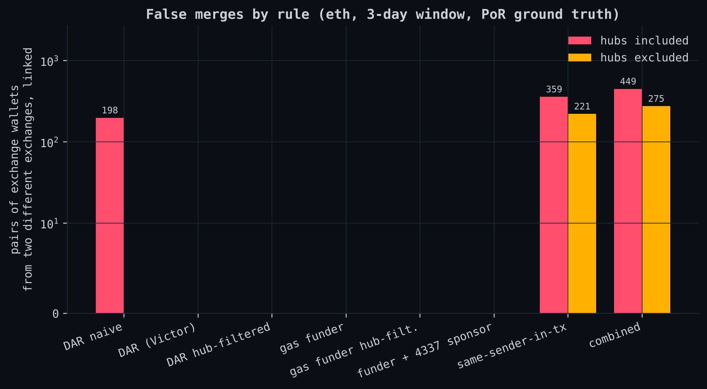
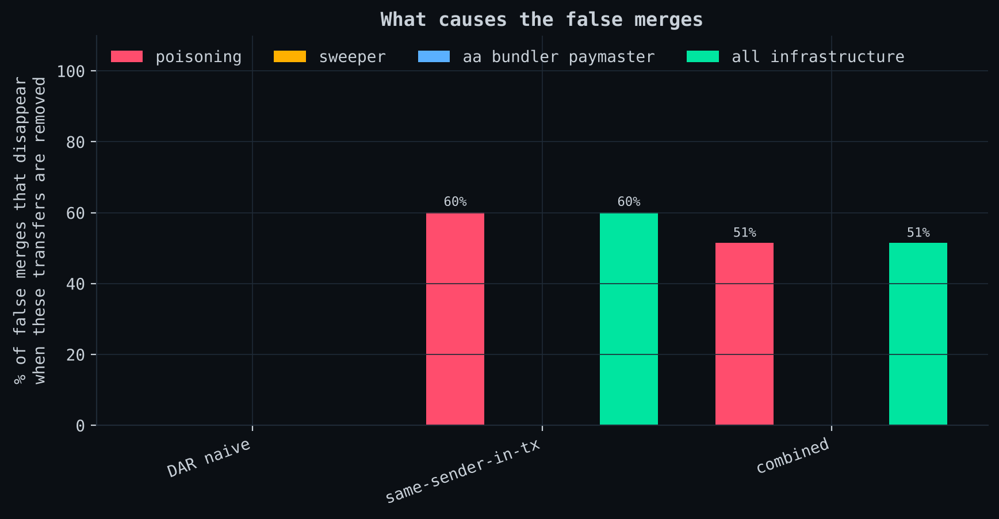
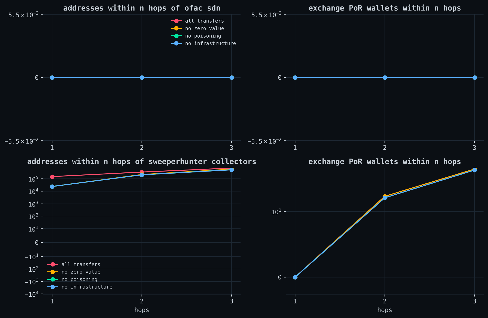
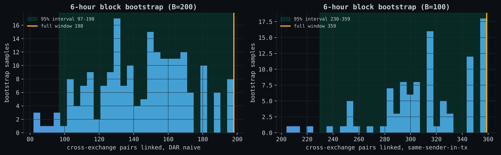
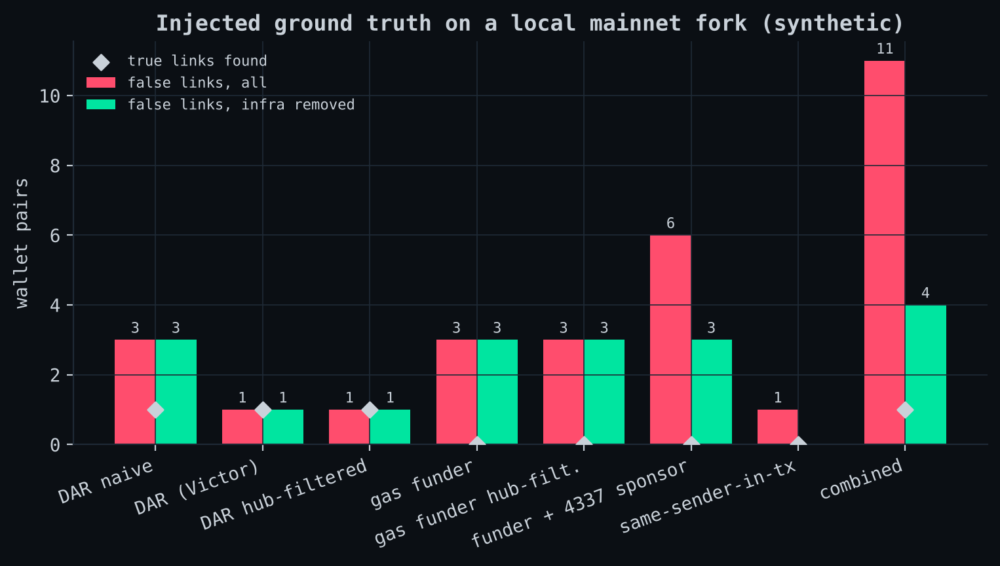

# evm-cluster-check

**On 3 days of Ethereum data (1 to 3 November 2026, 5.44 million transactions), the naive deposit-address-reuse rule merged 198 pairs of addresses that belong to two different exchanges. 0% of those false merges came through poisoning transfers, sweeper contracts or shared fee-paying services: every one runs through a high-volume hub address, and all 198 disappear when the 366 hubs are excluded. The same-sender-in-transaction rule merged 359 such pairs, and 60% of those came only through poisoning transfers.**

| Rule (hubs included) | Addresses clustered | Labelled pairs linked | Known-wrong links | Wrong links caused by infrastructure |
|---|---|---|---|---|
| Deposit-address reuse, naive | 10,892 | 435 | **198** | 0 (0%) |
| Deposit-address reuse, Victor (2020) as published | 8,848 | 0 | 0 | 0 |
| Deposit-address reuse, hubs filtered | 9,668 | 0 | 0 | 0 |
| Common gas funder | 345,209 | 0 | 0 | 0 |
| Common gas funder, hubs filtered | 144,375 | 0 | 0 | 0 |
| Gas funder + ERC-4337 sponsor | 377,790 | 0 | 0 | 0 |
| Same sender in one transaction | 226,018 | 630 | **359** | 216 (60%) |
| All rules combined | 542,190 | 780 | **449** | 231 (51%) |

*Labelled pairs* are pairs of addresses that both appear on an exchange's proof-of-reserves (PoR) list. A link between two addresses from **different** exchanges' lists is known to be wrong. A link is *caused by infrastructure* when it disappears after poisoning transfers, EIP-7702 sweeper transfers and ERC-4337 bundler/paymaster transfers are removed and the rule is re-run.



These are open, published rules run on public data. This project does not measure Chainalysis, Elliptic, TRM or any commercial product, and says nothing about how they cluster.

## Why this matters

Investigators and compliance teams group addresses into clusters and treat a cluster as one person or company. A false merge puts a stranger's money inside someone's cluster. Bitcoin clustering now has published error studies. For Ethereum-style chains, where most stablecoin money moves, the published heuristics (Victor 2020, Tutela 2022) report how much they cluster but not how often they link two different owners. This repository measures that against ground truth: addresses that exchanges themselves list in their proof of reserves.

## Results

### 1. Infrastructure explains the same-sender rule's errors, not deposit-address reuse



| Rule | False merges | Without poisoning | Without sweepers | Without bundlers/paymasters | Without all three |
|---|---|---|---|---|---|
| Deposit-address reuse, naive | 198 | 198 | 198 | 198 | 198 |
| Same sender in one transaction | 359 | 143 | 359 | 359 | 143 |
| All rules combined | 449 | 218 | 449 | 449 | 218 |

Poisoning transfers (zero-value or look-alike transfers that appear to come "from" a victim) put many unrelated senders into one transaction, and the same-sender rule reads that as common ownership. Sweeper and bundler/paymaster transfers did not cause any false merge in this window. Deposit-address reuse fails a different way: see section 3.

### 2. Hubs: report every number twice

| Rule | Known-wrong links, hubs included | Known-wrong links, hubs excluded |
|---|---|---|
| Deposit-address reuse, naive | 198 | 0 |
| Same sender in one transaction | 359 | 221 |
| All rules combined | 449 | 275 |

A *hub* here is an address with 1,000 or more distinct counterparties in the window (366 addresses). The threshold is my choice, not a published one, so it is only ever shown as a separate column. Exchange hot wallets are hubs, which is why excluding them also shrinks the labelled set from 85 active PoR addresses to 60.

### 3. What the false merges really were (20 sampled chains)

For 20 randomly sampled cross-exchange links, `src/handcheck.py` found the shortest chain of rule links between the two exchanges' addresses and classified it from the transactions on that chain (`results/handcheck_eth.csv`). These were classified by script from the on-chain transactions, not reviewed one by one on a block explorer.

| What the chain went through | Chains (of 20) |
|---|---|
| Poisoning transfers sharing one transaction | 13 |
| An exchange wallet paying another exchange's deposit address, read as a customer | 9 |
| An unlabelled high-degree hub | 6 |
| A third exchange's wallet | 3 |
| An exchange withdrawal read as gas funding | 1 |
| Nothing these rules explain | 2 |

A chain can have several causes, so the column sums to more than 20. The deposit-address-reuse errors come from exchanges paying each other: when exchange A withdraws to exchange B's deposit address, A's hot wallet looks like one of B's customers. Victor's published rule makes none, largely because its 1,000-address cluster cap drops the giant clusters where these merges live (see what-went-wrong item 15). None of the 20 could be confirmed as genuine shared custody, but shared custody cannot be ruled out from chain data alone.

### 4. Taint: most one-hop exposure arrives by zero-value transfers

| Edges used | 1 hop | 2 hops | 3 hops | Exchange PoR wallets reached at 3 hops |
|---|---|---|---|---|
| All transfers | 147,611 | 340,651 | 711,240 | 52 (6 exchanges) |
| Zero-value transfers removed | 23,812 | 216,014 | 579,533 | 52 (6 exchanges) |
| All poisoning removed | 23,794 | 205,098 | 523,718 | 50 (6 exchanges) |
| All infrastructure removed | 23,774 | 204,980 | 515,449 | 50 (6 exchanges) |

Seeds: the 30 attacker collector addresses from the SweeperHunter EIP-7702 dataset that were active in the window. 84% of addresses "tainted" at one hop are reached only through zero-value transfers, which move no money. A proportional (haircut) taint rule, which follows only value, marks 205,090 addresses with any tainted share but only 5,966 with 1% or more. None of the 127 OFAC-listed Ethereum addresses was active in the window, so the OFAC seed set tainted nothing.



### 5. Uncertainty



Resampling the window in 6-hour blocks (200 resamples for deposit-address reuse, 100 for same-sender) gives a 95% range of 97 to 198 false merges for naive deposit-address reuse and 230 to 359 for the same-sender rule. The full-window count sits at the top of each range because a resample with repeated blocks contains fewer distinct transactions. Day by day, naive deposit-address reuse made 99, 63 and 84 false merges.

### 6. Injected ground truth (wallets I control, on a local fork)

On a local `anvil` fork of mainnet I created wallets, sent them zero-value poisoning transfers, routed them through a shared paymaster and funded them from a common "exchange" wallet, then ran every rule (`anvil/`, `results/injected.csv`).

| Rule | False links | False links with infrastructure removed |
|---|---|---|
| Gas funder + ERC-4337 sponsor | 6 | 3 |
| Same sender in one transaction | 1 | 0 |
| All rules combined | 11 | 4 |

The sponsor rule linked the shared paymaster to two of my unrelated wallets, and one poisoning transfer made the same-sender rule link two unrelated wallets. Both links disappear when infrastructure is removed, as on mainnet.



### 7. Second chain: Base

A 6-hour Base window (10,800 blocks, 1.29 million transactions) had only 13 active PoR addresses, so it is too small to say much. The combined rules made 8 cross-exchange links there, 7 of them (88%) caused by infrastructure. Figures are in `docs/img/*_base.png` and numbers in `results/*_base.*`.

### 8. Reproducing published numbers

Full-history reproduction of Victor (2020) and Tutela (2022) was not possible on three days. What can be compared:

| Quantity | Victor (2020) | This window |
|---|---|---|
| 95th percentile of deposit amount difference | 0.0083 ETH | 0.46 ETH |
| 95th percentile of forwarding delay | 3,185 blocks | 4,829 blocks |
| Share of deposit users who share a deposit address | 44.3% | 24.2% |

| Quantity | Tutela (2022) | This window |
|---|---|---|
| Mean multi-address cluster size | 4.3 | 2.9 |
| Largest cluster | 2,100 | 102 |

The numbers do not match closely. Three days, a 2026 fee market and a different token mix all plausibly explain the gaps, but I have not shown which, so this is recorded as unreproduced (`results/reproduce_eth.json`).

### 9. Is the input data right?

The companion project [chain-evidence](https://github.com/itsashutoshpsingh/chain-evidence) re-fetched 40 sampled blocks of this window, recomputed each block's receipts root from the receipts, and compared the result with what this project stored: all 19,640 Transfer logs matched, with none missing, extra or altered.

## Data

| Input | Source |
|---|---|
| Ethereum blocks 26,316,189 to 26,337,722 | Free public RPC endpoints (publicnode, drpc), see `data/README.md` |
| Base blocks 53,350,927 to 53,361,726 | Free public RPC endpoints |
| Same-owner ground truth | Exchange proof-of-reserves address lists (9 exchanges, 452 addresses) |
| Sanctioned addresses | OFAC SDN list |
| Sweeper contracts and collectors | SweeperHunter dataset (pinned commit, see `Makefile`) |
| Bundlers and paymasters | ERC-4337 EntryPoint events in the window |

No raw chain data is committed. Only aggregate counts are published. No address in this repository is claimed to belong to a named person, and none is called a criminal or a victim.

## Reproduce

```bash
make setup
make inputs
make fetch    # about 70 min for Ethereum and 60 min for Base on free endpoints
make run      # needs about 12 GB of RAM for the 3-day window
make figures
make notebook
make test
```

The injected tests need Foundry's `anvil` running locally (`make injected`).

## Repository

| Path | What it is |
|---|---|
| `docs/method.md` | Exact definition of every rule, label and metric |
| `docs/reading-notes.md` | Notes on Victor, Tutela, Müller et al., Tsuchiya et al., Chainalysis |
| `docs/what-went-wrong.md` | Every miss, dead end and limit, and what it does to the numbers |
| `notebooks/01_week1_result.ipynb` | Every table above, read from `results/` |
| `src/` | Fetch, ground truth, rules, infrastructure labels, taint, scoring |
| `anvil/` | Injected ground-truth tests on a local fork |
| `results/` | Every number in this README |

## What went wrong

The full list is in [docs/what-went-wrong.md](docs/what-went-wrong.md). The ones that matter most:

- **Binance and Bitstamp are missing from the ground truth**, so every false-merge count is a lower bound.
- **Only one provider served Ethereum logs**, so the ERC-20 data has no second source. The chain-evidence audit above is the check on it.
- **No internal transfers or transaction status.** ETH moved by contract code is invisible to every rule, and transfers from reverted transactions are counted.
- **Three days is short**, and the hub threshold is my own choice.
- **The 20 false merges were classified by script**, not reviewed on a block explorer.

## Licence

MIT. See [LICENSE](LICENSE).
